# Simulation tab: how to use it, and why

**Where:** Alpha & Options Lab → **Stocks → Simulation** (between *Expectancy & Kelly* and *Trade ranker*).
**What it answers:**

1. What tends to happen after a signal like this one, traded my way? (**1 · Forward paths**)
2. Which indicators actually help me pick trades within a setup, once I'm honest about overlap and luck?
   (**2 · Indicator model**)
3. Given what I know and don't know about a setup's edge, how much should I risk, and what might the next 100
   trades look like? (**3 · Next trades**)

Each view is a different kind of simulation: Monte Carlo on real price paths, MCMC on a model, and Bayesian
Monte Carlo from that model's posterior. They are built to disagree with you when the data does.

> Everything below uses your real bars and ledger. The demo source produces random numbers that mean nothing;
> use demo only to learn the controls.
>
> The pictures below are from the demo source, so read them for layout, not results. The numbered badges
> match the list under each picture. In VS Code, open this file with **Ctrl+Shift+V** (Markdown preview) and
> keep the `readme_images` folder next to it.

---

## Contents
1. [Before you start](#1-before-you-start)
2. [A routine that uses it well](#2-a-routine-that-uses-it-well)
3. [Shared controls](#3-shared-controls)
4. [View 1 · Forward paths (Monte Carlo)](#4-view-1--forward-paths-monte-carlo)
5. [View 2 · Indicator model (MCMC)](#5-view-2--indicator-model-mcmc)
6. [View 3 · Next trades (posterior predictive)](#6-view-3--next-trades-posterior-predictive)
7. [Cheat sheet: what good looks like](#7-cheat-sheet-what-good-looks-like)
8. [Messages you may see](#8-messages-you-may-see)
9. [Files, timing and where the methods come from](#9-files-timing-and-where-the-methods-come-from)

---

## 1. Before you start

**The tab runs on the Setup ledger.** If no ledger has been built this session, the tab shows *Build the ledger
with its current settings*; that button uses whatever is set on the Setup ledger tab. Every simulated trade takes its
entry, stop and costs from the ledger. The exits come from the tab's **Exits** switch (section 3): its own
**trim and trail** plan by default, or the ledger's exits.

| Ledger setting | What the simulation does with it |
|---|---|
| Entry (next open / buy stop) | How each simulated trade gets filled |
| Target (R), Exit (fixed / trailing / per family), trailing stop kind and k | How each simulated trade exits under *The ledger's exits*. Trim and trail uses the chandelier's k when you pick that runner exit |
| Time limit (off / same / per family) | When a simulated trade is closed for time, under *The ledger's exits* only. Trim and trail has no time limit |
| Widest stop (ATR) | The stop is held between 0.5 ATR and this cap, exactly as in the ledger |
| Costs, Cost model (flat / + half the estimated spread) | Charged on every simulated trade |
| Holdout: last share of dates | The cutoff for every out-of-sample check in this tab |

**Why it matters:** the entries and stops are always *your* system's. The exits are a choice you can test: the
single-signal view runs both plans on the same paths, so you see what each one is worth before you change how you
trade.

**Universe.** If the ledger was built for both universes, a *Universe* switch appears. Forward paths need the daily
bars, which are kept for **Your list**. The model and the predictive view work on either universe. The whole-market
universe has less survivorship bias, so it is the more honest place to fit the model if you built it.

---

## 2. A routine that uses it well

**Weekly, or whenever you rebuild the ledger:**

1. **View 2**, *Fit on: Dates before the holdout*, then **Fit the model**. Read *Did the indicators predict the
   holdout?* first. That panel decides how much you trust everything else.
2. If the indicators held up (information coefficient t ≥ 2), switch to *Fit on: All dates* and fit again. That
   gives the posterior with the most data, for live use.
3. **View 3**: run through the setups you trade. Note *P(the edge is real)* and the half or cautious Kelly
   for each.

**Whenever you change the exit settings:** open a few signals of each setup you trade in view 1. Read *The same
look-alike paths under both exit plans* before you refit view 2, because the model is fitted on trades scored with
the plan you're on.

**Each evening, on the night's signals:**

1. **View 1**, with *Signals: The Brief's top names* (the default): the table at the top simulates every name the
   Brief put first. Start with the names marked *supports*, look closer at the *mixed* ones, and be wary of a Brief
   pick the simulation calls *against*.
2. Under *Look closer at one signal*, open each name you're considering. Keep the ones whose look-alike 90% band
   sits above zero and which beat *This setup, all signals*, with enough *effective* look-alikes.
3. **View 3**, *Indicators at: a Brief name's signal*: check that the model agrees for that signal, then size it.

**Monthly:** open *Do look-alikes beat the setup's plain average?* at the bottom of view 1. If the information
coefficient has gone to zero, stop leaning on the look-alike numbers.

**Why this order:** the model's holdout check is the strongest test in the tab, so it gates the rest. Look-alikes are
vivid but noisy one signal at a time, so use them to shortlist and the model to confirm.

---

## 3. Shared controls

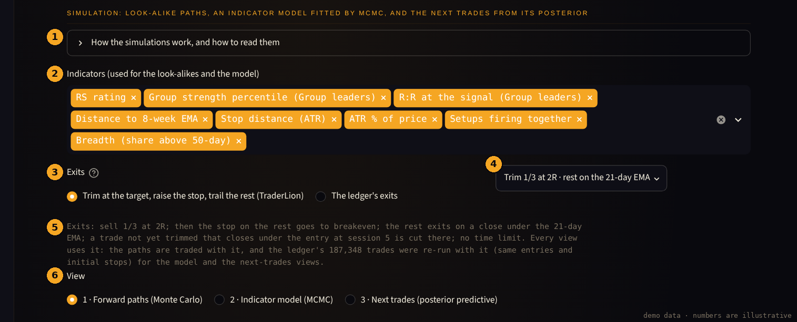

**1** *How the simulations work* (the in-app guide) · **2** the indicator picker · **3** the exits switch ·
**4** the trim-and-trail settings · **5** the plan in words · **6** the view switch

### Indicators (used for the look-alikes and the model)
**How:** pick 5–10 indicators you would actually trade on. The default set is RS rating, group strength percentile,
R:R at the signal, distance to the 8-week EMA, stop distance in ATR, ATR % of price, setups firing together, and
breadth. That covers your group-strength / asymmetric-R:R rule plus volatility and market context. Any numeric
ledger feature with enough coverage can be added.

**Why that way:**

- **Fewer is better for look-alikes.** In many dimensions every past signal is about equally far away, so the
  "nearest" ones stop being near and the effective number of look-alikes collapses. Five to ten indicators keep the neighbours
  meaningful.
- **Choose before you look.** Swapping indicators until the numbers look good is another variant tried. If you do
  iterate, raise *Other variants tried* on the Setup ledger so the Deflated Sharpe charges for it.
- Changing the set marks the model as stale (view 2 says so), so refit after changing it.

### Exits
**How:** leave it on **Trim at the target, raise the stop, trail the rest (TraderLion)** unless you want to see the
Setup ledger's own exits. The button beside it opens the settings:

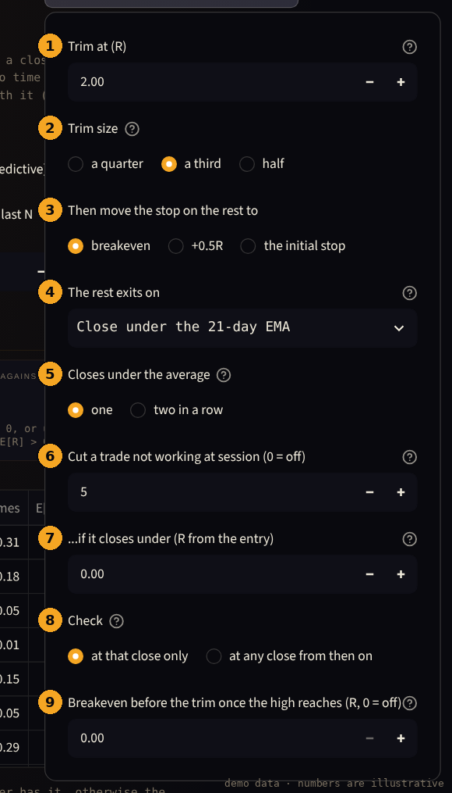

| # | Setting | Default | What it does |
|---|---|---|---|
| 1 | **Trim at (R)** | 2 | The price target, in multiples of the initial risk. Reaching it sells the trim share at the target (or at the open, if it gapped over). |
| 2 | **Trim size** | a third | The share sold at the target. The rest keeps running with no target. |
| 3 | **Then move the stop on the rest to** | breakeven | The stop on the rest after the trim: breakeven, +0.5R, or the initial stop. A trimmed trade can then only lose through a gap. |
| 4 | **The rest exits on** | close under the 21-day EMA | The exit for the rest: a close under the 10-day EMA, 21-day EMA or 50-day SMA, or the chandelier stop (high minus k ATR). It applies only after the trim. |
| 5 | **Closes under the average** | one | Two in a row waits out one-day shakeouts. |
| 6 | **Cut a trade not working at session** | 5 | A time stop: a trade not yet trimmed that closes under the level in 7 at this session is sold at that close. 0 turns it off. |
| 7 | **...if it closes under (R from the entry)** | 0 | 0 = under the entry price, so "not above my entry after 5 sessions". −0.25 = a quarter of the risk under it. |
| 8 | **Check** | at that close only | *At any close from then on* is stricter: any later close under the level ends the trade too. |
| 9 | **Breakeven before the trim once the high reaches** | off | Moves the stop to breakeven early, on follow-through. |

**Why that way:** a fixed target sells everything at 2R, so the few trades that would have run to 8R count as 2R.
Those few are where a breakout system makes its money. TraderLion's selling rules handle this in steps, and the plan
follows them:

- **Sell part into strength.** TraderLion's examples sell part at 1–3R. Kristjan Kullamägi sells 1/3 to 1/2 after
  3–5 days. Oliver Kell sells 1/4 to 1/2 at 3–5R in the first 3–5 days.
- **Raise the stop on the rest to breakeven** ("tighten your stop to breakeven or just above").
- **Trail the rest with the 10- or 21-day EMA**, and the 50-day for slower names. TraderLion suggests waiting for
  two closes under the average.
- **Cut what isn't working.** TraderLion gives no fixed day count for this. The default is one time stop: still under
  the entry at the close of session 5 means it isn't working, so it's sold there. Checking every close from session 5
  on shortens losers a little more. On demo data it also cut half again as many trades, some of which would have
  won.

The result: winners are held for weeks and losers for days. A trimmed trade that comes back to breakeven still
banks +0.67R (a third at 2R). The model and next-trades views re-run the ledger's own trades under the plan (same
entries, same initial stops), so all three views score one plan. With *The ledger's exits*, everything works as it
did before this switch existed.

### View
Three views of one tab: **1 · Forward paths**, **2 · Indicator model**, **3 · Next trades**. The controls of this
tab rerun only this tab, so switching is fast.

---

## 4. View 1 · Forward paths (Monte Carlo)

### What it does
For the signal you pick:

1. It finds the **past signals of the same setup that looked most like it** on your indicators. Its family is used if
   the setup has fewer than 40 usable past signals.
2. It takes the **price path that followed each one** (open, high, low and close for each session), using only past
   signals whose whole window ended **before** this signal's date. Nothing after the signal is used.
3. It **rescales each path to this name's volatility** (each daily move × today's ATR % ÷ that signal's ATR %,
   limited to 0.33–3×) and starts it at this signal's close, with the name's real history in front.
4. It **trades every path with this signal's stop, the ledger's entry and costs, and the exit plan**, through the
   same code that labels the ledger. A unit test confirms that a past signal's own path, at its own volatility, gives
   exactly the ledger's R under the ledger's exits.
5. It also runs **the other exit plan on the same look-alike paths**, for the comparison table.

Two reference sets go through the same rules: **all of this setup's past signals** (up to 2,000) and **random
uptrend names** (the ledger's baseline, up to 2,000).

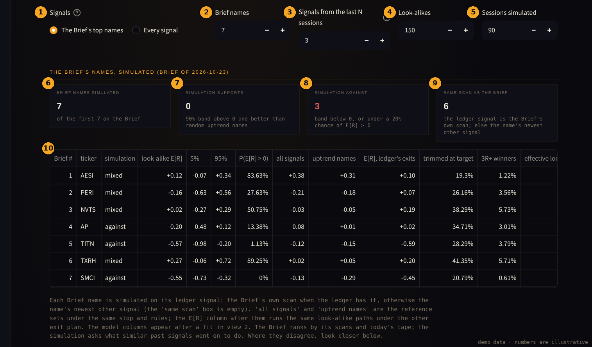

**1–5** the controls below · **6** Brief names simulated · **7** Simulation supports · **8** Simulation against ·
**9** Same scan as the Brief · **10** the Brief's names, simulated

*Reading this example:* of the Brief's seven card names, none clears the *supports* bar, and three come back
*against*: AP, TITN and SMCI (−0.20R, −0.57R and −0.55R). TXRH has the best look-alike E[R] (+0.27R, 89% chance it's
above zero), but its band still crosses zero. The *E[R], ledger's exits* column shows that the exit plan matters
name by name. Trim and trail does better for AESI and TXRH (+0.12R vs +0.10R, +0.27R vs +0.20R) and worse for PERI,
NVTS and AP. Open a name under *Look closer* to see why.

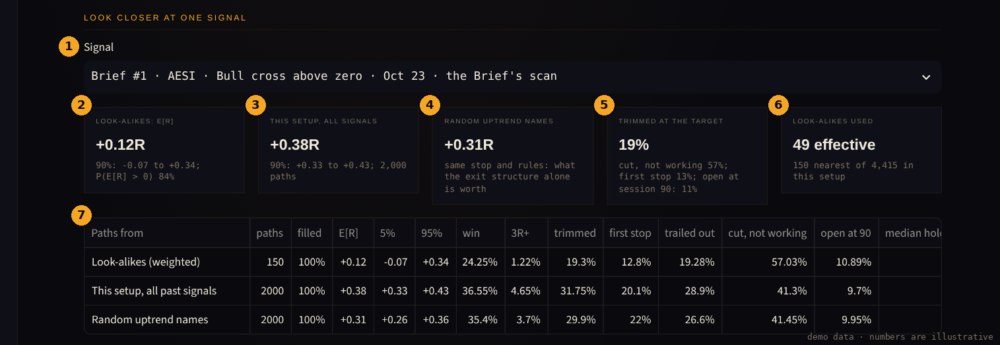

**1** the signal picker · **2** Look-alikes: E[R] · **3** This setup, all signals · **4** Random uptrend names ·
**5** Target before stop (*Trailed out* for trailing exits) · **6** Look-alikes used · **7** the outcome table

*Reading this example:* this is AESI, the Brief's #1, on the Brief's own scan. Its look-alikes (+0.12R) do worse
than the setup's signals in general (+0.38R) and than random uptrend names (+0.31R). Of its look-alike trades:

- 19% reached the trim
- 57% were cut at session 5 for not working
- 13% hit the first stop
- 11% are still open at session 90

### Controls

| Control | Default | How and why |
|---|---|---|
| **Signals** | The Brief's top names | **The Brief's top names** takes the names Brief > Setups puts first and simulates their ledger signals (see below). **Every signal** lists whatever fired recently, newest first. Start from the Brief: it has already filtered for liquidity, range and your scans, and the simulation is the second opinion. |
| **Brief names** | 7 | How far down the Brief's list to go. 7 = the cards on the Brief (3 for today's focus, 4 for this week's). Up to 25 takes in the rest of the names that fired, triggered or are setting up, by the Brief's rank. |
| **Signals from the last N sessions** | 3 | Which signals appear in the picker. Today's only = 0. For the Brief's names the window is at least 5 sessions, the Brief's own "this week". Older signals are simulated from their signal day (what you'd have seen then); if the trade has since closed, the note shows the real result, which is a quick reality check. |
| **Signal** (under *Look closer at one signal*) | the Brief's order | Ticker · setup · signal date. Brief names come first, labelled *Brief #n*, with *the Brief's scan* when the ledger signal is the scan the Brief listed it for. |
| **Look-alikes** | 150 | How many nearest neighbours to use. More is steadier but less alike; fewer is more alike but noisier. Watch *effective* look-alikes, not this number (see below). For setups with thousands of past signals, 150–300 works; for thin setups, the family fallback kicks in automatically. |
| **Sessions simulated** | 90 | How far each path runs. The rest of a trimmed trade has no time limit, so it needs room. If *open at 90* in the table is above ~20%, lengthen the window. A time limit shorter than the window is applied as in the ledger; no limit (or a longer one) marks trades still open at the end at the last close. |

### The Brief's names, simulated
**How the names get here:** each time Brief > Setups runs (it runs with the page), it saves its ranked list:
today's focus cards, then this week's, then the rest by its rank. Each name keeps the ledger setups its scans map to
(MACD setups, the TraderLion pads, the 8-week pocket, BoxTrader, the RS-line breakout, Stockbee's EP 9 million). The
Simulation finds each name's ledger signal from the last 5+ sessions, the Brief's own scan first, otherwise the name's
newest other signal. An EP 9M name is simulated against the ledger's EP family, with the EP day's low as the stop; that
needs the ledger built with the EP family on (it is by default).

**The table:** one row per Brief name, in the Brief's order.
- **Brief #**, **on the Brief as**, and **the Brief's signal**: where and why the Brief listed it.
- **ledger signal simulated** and **same scan**: what was simulated, and whether it is the Brief's own scan.
- **look-alike E[R]** with **5% / 95%** and **P(E[R] > 0)**: the same numbers as the single-signal tiles below.
- **all signals** and **uptrend names**: the two reference sets, under this signal's stop and rules.
- **E[R] under the other exit plan**: the same look-alike paths run under the other exit plan. It's *ledger's
  exits* when you're on trim and trail, and the other way round.
- **trimmed at target** (*target first* or *exit share* under the ledger's exits), **3R+ winners**, **effective
  look-alikes** and **open at H**.
- **model E[R]** and **model P(edge)**: view 2's read for this signal, once you've fitted the model.
- **simulation**, the verdict:
  - *supports*: the 90% band is above zero and beats random uptrend names
  - *against*: the band is below zero, or there's under a 20% chance the look-alike E[R] is positive
  - *mixed*: everything in between
  - *(thin)* is added under 30 effective look-alikes

Names the Brief lists but the ledger has no signal for are named under the table. The RS-leader scan has no ledger
setup, and some signals fire before the window.

**Why it's built this way:** the Brief ranks names by its scans and today's tape (relative volume, gaps, group
strength). The simulation asks a different question: what did similar past signals of this setup go on to do,
under your exits? When the two agree, you have two independent reasons. When the Brief's top pick comes back
*against*, that disagreement is the most useful thing on the page: open it under *Look closer* and see why.

**If the table doesn't appear:** the Brief saves its list when it runs, so on the very first load the tab shows every
signal and a note. Any click afterwards picks the list up.

### Reading the tiles
- **Look-alikes: E[R]** is the weighted average R of the look-alike trades, with a 90% band from a Bayesian
  bootstrap and *P(E[R] > 0)*. Green when the whole band is above zero, red when it's all below.
- **This setup, all signals** is the same, for every past signal of the setup. This is the setup's base rate under
  *today's* stop and volatility.
- **Random uptrend names** is the same rules on random uptrend names: what the exit structure alone is worth. A
  setup is only interesting if it beats this.
- **Trimmed at the target** (trim and trail) shows how often the trim happened, with how often trades were cut for
  not working, stopped at the first stop, or still open at the end. Under the ledger's exits it's **Target before
  stop** (fixed targets) or **Trailed out** (trailing exits).
- **Look-alikes used** shows *effective* look-alikes (Kish's n_eff of the weights), out of the nearest K and the
  pool size, and where the pool came from.

**Why three sets:** they separate three questions. Is this setup better than random entries under my exits
(*all signals* vs *uptrend*)? Do the indicators add anything for this signal (*look-alikes* vs *all signals*)? Is
any of it more than noise (the bands)?

### The table
For each set:

- paths, and the share **filled** (below 100% with buy-stop entries)
- **E[R]** with **5% / 95%**, **win**, and **3R+** (the share of trades that made 3R or more)
- how trades ended: **trimmed**, **first stop**, **trailed out**, **cut, not working** and **open at H**. Under the
  ledger's exits these are **target** and **time** instead of trimmed and cut
- **median hold** for winners and for losers separately, and **median MAE** (how far the trade went against you, in R)

### The same look-alike paths under both exit plans
One column per plan, on the same look-alike paths with the same entry and initial stop. Only the exits differ.

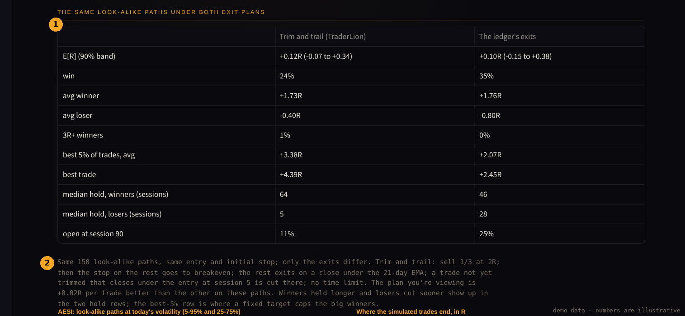

**1** the comparison · **2** the note: the plan in words and the difference in E[R]

*Reading this example:* on AESI's 150 look-alike paths, trim and trail earns +0.12R a trade against +0.10R for the
ledger's exits: about the same, but for different reasons.

- The average loser is half the size (−0.40R vs −0.80R), because losers are out after 5 sessions instead of 28.
- The best 5% of trades average +3.38R instead of +2.07R, and winners are held 64 sessions instead of 46, because
  the rest of the position is no longer sold at the 2R target.
- The cost is the win rate (24% vs 35%): a trade cut at a small loss counts as a loser.

**How to read it:** look at *best 5% of trades, avg* and *best trade* first. Under a fixed target those sit near the target,
because the exit caps them. Then compare *median hold, winners* with *median hold, losers*: the plan should hold
winners longer and cut losers sooner. *avg loser* shows what the cut saves on each loser.

**Why it's there:** E[R] alone hides the trade-off. The trim plan usually wins fewer trades (a trimmed trade stopped
at breakeven still counts as a win, but a trade cut at −0.3R counts as a loss). In exchange it keeps the right tail
and shrinks the losers. Whether that adds up depends on your setups' paths, and this table shows it per signal.

### The charts
- **Look-alike paths at today's volatility** shows the 5–95% and 25–75% bands of the simulated closes by session, the
  median path, and the **effective stop** (after the ledger's 0.5–3 ATR floor and cap). The trim (or target) is drawn
  approximately, because the real entry is the next open.
- **Where the simulated trades end, in R** shows look-alikes as bars. Step lines show all signals, uptrend names, and
  the look-alikes under the other exit plan (green). It's clipped at −3R and +12R. Look at the shape, not just the
  mean:
  - two spikes at −1 and +2 is a fixed-target trade
  - a pile just under zero (the cuts), a spike at +0.67 (trimmed, then out at breakeven) and a long right tail is
    trim and trail

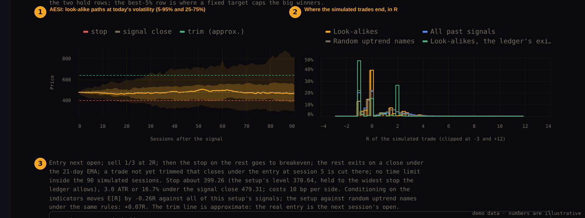

**1** look-alike paths with the effective stop and approximate target · **2** where the trades end, in R ·
**3** the note under the charts

*Reading this example:* the setup's own level sat 22.7% under the close, so the ledger held the stop to its 3 ATR
cap, and the note says so. The look-alikes (amber) pile up just under zero: those are the session-5 cuts, at small
losses. A smaller group sits between 0 and +2R, and a thin tail runs past it. The green line is the ledger's exits on
the same paths, with the two spikes at −1R and +2R of a fixed target.

### The note under the charts
It states the rules used, where the stop sits (in ATR and %, and whether the ledger's cap moved it), the costs, how
much conditioning moved E[R], and warnings: too few effective look-alikes, or too many trades still open at the
window's end.

### *The N nearest look-alikes* (expander)
Each neighbour's ticker and date, **its own R** in the ledger (with its own stop), **R with today's stop and vol**
(the re-simulated trade), the distance, the weight and the vol rescale.

**Why look:** if the neighbours cluster in one month or one name, the forecast is really one episode. If many need a
2–3× vol rescale, the paths are being stretched a lot.

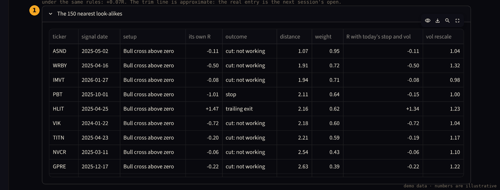

**1** the expander, opened

*Reading this example:* PBT's own trade hit its stop for −1.01R, but on the same path with this signal's wider stop
it costs only −0.15R. That's the re-simulation at work: the same path, with this signal's risk. Under trim and trail,
most of the nearest look-alikes were cut at session 5 for small losses (−0.06R to −0.72R), and HLIT trimmed and trailed
out for +1.47R. Rescales of 1.0–1.3× are normal; a column full of 3.00 would mean the paths are being stretched to
fit.

### *Do look-alikes beat the setup's plain average? (out of sample)*
**How:** press **Run the check** (it remembers the result for these settings).
**What it does:** for every completed trade after the holdout cutoff, it forecasts R from that trade's nearest
look-alikes before the cutoff (the same setup and indicators) and compares the forecast with the setup's plain
average. One vote per setup and date.

- **Information coefficient** is the rank correlation of the forecast's deviation with the realized deviation. 0.02–0.05
  is a real but small edge; ≤ 0 means the look-alike numbers add nothing.
- **Top third minus bottom third** is the realized R gap between the best- and worst-forecast thirds.
- **Out-of-sample R squared** vs the setup's average is usually tiny or negative even when the ranking works. Read the
  information coefficient first.
- The per-setup table shows where the conditioning helps and where it doesn't.

**Why it uses each look-alike's own R and not re-simulated paths:** it tests whether the *indicators* carry
information, separately from the path machinery, and it runs in seconds.

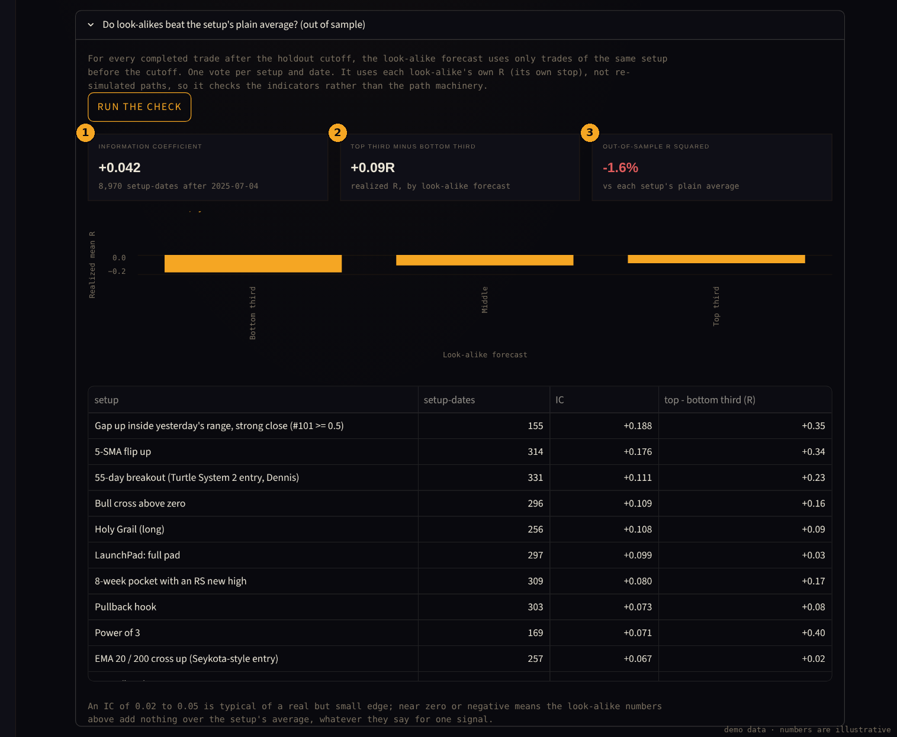

**1** Information coefficient · **2** Top third minus bottom third · **3** Out-of-sample R squared; below them,
realized R by forecast third and the per-setup table

*Reading this example:* an IC of +0.042, with the top third beating the bottom third by +0.09R, means the look-alikes
rank trades a little better than chance. The R squared of −1.6% says they don't forecast the size of R. Use them to
choose, not to size.

### How to act on view 1
- **Shortlist** a signal when the look-alike band is above zero, look-alikes beat *all signals*, *effective* ≥ 30
  (ideally 60+), and *open at H* is small.
- **Skip or downsize** when the band straddles zero and the setup barely beats uptrend names.
- **Don't** treat one signal's look-alike E[R] as a forecast to size from. That is view 3's job.

---

## 5. View 2 · Indicator model (MCMC)

### What it does
- **The data:** one row per setup and signal date, holding the average R of that date's completed trades. That is one
  vote per date, as on the scoreboard.
- **The regression:** R on the indicators, **centred within each setup**, so a coefficient answers "among this setup's
  signals, does more of this help?"
- **Pooling:** setups are **pooled within their family**, so a thin setup borrows from its family instead of standing
  alone.
- **Fat tails:** errors are Student-t, so a few monster winners can't steer the fit.
- **Overlap:** trades overlap in time, so the likelihood is **tempered by an overlap factor k** (from Newey-West). Each
  date counts as 1/k of an independent observation, and every interval is about √k wider than a naive fit's.
- **Sampling:** a Gibbs sampler in numpy runs several chains. The family means and the spread of setups within a
  family are drawn as collapsed blocks, so tight families mix well.

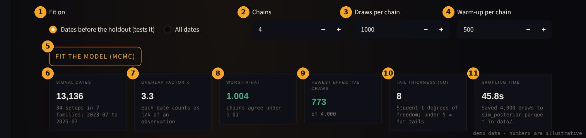

**1–5** the controls below · **6** Signal dates · **7** Overlap factor k · **8** Worst R-hat · **9** Fewest effective
draws · **10** Tail thickness (nu) · **11** Sampling time

*Reading this example:* R-hat 1.004 and 773 effective draws mean the chains agree and the intervals are stable.
k = 3.3 means about every three signal dates count as one independent observation.

### Controls

| Control | Default | How and why |
|---|---|---|
| **Fit on** | Dates before the holdout | Fit on the discovery dates first: the holdout panel then tells you whether the indicators predicted the future. Once you've seen that, refit on **All dates** for live use. Don't go back and forth tuning against the holdout; every look spends it. |
| **Chains** | 4 | Independent runs from different starting points; R-hat compares them. Four is enough. |
| **Draws per chain** | 1000 | Kept draws per chain. Raise it if *Fewest effective draws* is under ~400. |
| **Warm-up per chain** | 500 | Discarded burn-in. Raise it if traces trend at the start. |
| **Fit the model (MCMC)** | | Runs it (about 5–30 s for a few thousand to ~15,000 signal dates), then saves the posterior. |

### Reading the tiles
- **Signal dates** shows the rows used, the setups and families (setups need at least 10 dates in the fit sample), and
  the date span.
- **Overlap factor k** is how many neighbouring rows make one independent observation. Typical values are 2–5 for
  swing holds.
- **Worst R-hat** should be under 1.01 (green); up to 1.05 is acceptable (amber); above that, refit with more draws.
- **Fewest effective draws** should be at least 400 for stable 90% intervals.
- **Tail thickness (nu)** is the Student-t degrees of freedom. Under 5 means fat-tailed rows.
- **Sampling time** also reports where the posterior was saved.

### *What each indicator adds within a setup (pooled)*
- **Dots** are posterior medians; **bars** are 90% intervals, in **R per one standard deviation** of the indicator.
  Green means **helps** (P(helps) ≥ 95%), red means **hurts** (≤ 5%), grey means unclear.
- **The table** adds **1 s.d. in its own units**, so you can translate: e.g. "+0.06R per 20 points of RS rating".

**How to read it:**

- **Your cheat code is tested here directly.** If group strength percentile and R:R at the signal come out green on
  your real ledger, the rule is earning its keep within setups. If they're grey, the edge comes from the setups
  themselves, not from the filter.
- **Stop distance (ATR)** has a mechanical part: costs are a bigger share of a tight stop's R, and the 0.5–3 ATR floor
  and cap shape R. A positive coefficient there partly reflects trade construction, not stock picking.
- **An indicator that is green in-sample but fails the holdout is not an edge.**

### *Setups after pooling (dot) vs their raw average (blue diamond)*
- **The dot** is each setup's pooled expected R per trade (a true mean, corrected for the skew of R), with a 90%
  interval.
- **The diamond** is its raw average over the fit sample's trades.

The gap between them is the pooling. Setups with few dates move toward their family; well-sampled setups barely
move. A setup whose raw average looks great but whose pooled dot sits near its family is one where the sample is too
small to believe the raw number.

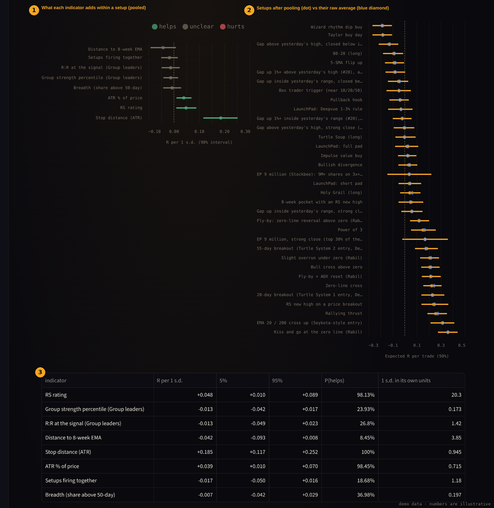

**1** what each indicator adds within a setup · **2** setups after pooling (dot) vs their raw average (diamond) ·
**3** the coefficient table

*Reading this example:* three indicators come out green:

- RS rating: +0.048R per 20 points, P(helps) 98%
- ATR % of price: +0.039R, 98%
- the stop distance: +0.185R, 100%

The stop-distance effect is bigger than under the ledger's exits, and most of it is mechanical. A trade cut at
session 5 a little under its entry loses a smaller share of a wide stop's R. Group strength and R:R are grey here,
but this is random demo data. On your real ledger, this chart is the direct test of your group-strength rule.

### *Did the indicators predict the holdout?* (only when fitting on dates before the holdout)
- **Holdout signal dates** is the size of the test.
- **Information coefficient** is the rank correlation between the indicator part of the forecast and the realized R
  (relative to each setup's level), **with t after the overlap charge**. t ≥ 2 is good evidence.
- **Out-of-sample R squared** vs the setup-only model: positive means the indicators improved the forecast of R
  itself. Trade outcomes are noisy, so this is often slightly negative even with a positive IC. That means the
  indicators **rank** trades but their **size** is overconfident: use them to choose, not to size.
- **Predicted vs realized** is the average over the holdout. A big gap means the holdout period was simply better or
  worse than the fit period (a regime shift), which no indicator fixes.
- **The quintile chart** shows realized R (bars) vs predicted R (blue dots) by quintile of the indicator forecast.
  You want the bars to rise from Q1 to Q5. If the dots rise much faster than the bars, the model is overconfident.

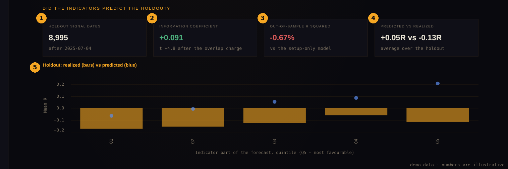

**1** Holdout signal dates · **2** Information coefficient · **3** Out-of-sample R squared · **4** Predicted vs
realized · **5** realized (bars) vs predicted (dots) by quintile

*Reading this example:* an IC of +0.091 with t 4.8 says the ranking held up. But the model overstates how much the
indicators matter. The predicted dots climb from about −0.06R to +0.21R, while the realized bars stay between about
−0.18R and −0.06R. The whole holdout also came in at −0.13R against +0.05R predicted: a weaker period that no
indicator fixes.

### *Does the Student-t fit the rows?*
This table compares observed and model quantiles of the per-date average R. R is bounded below near the stop and
skewed right, so the symmetric t usually puts too much in the far-left tail. When it does, a note says so: that
widens intervals but doesn't move coefficients much, and view 3 draws from your setup's **actual** residuals, not
from the t.

### Trace and *Diagnostics for every parameter*
- **Trace:** pick any coefficient, setup or scale parameter. The chains should overlap like noise, with no trends or
  separated bands.
- **Diagnostics** gives R-hat and effective draws for every parameter. If one setup misbehaves, it's usually a setup
  with very few dates; it will have wide intervals anyway.

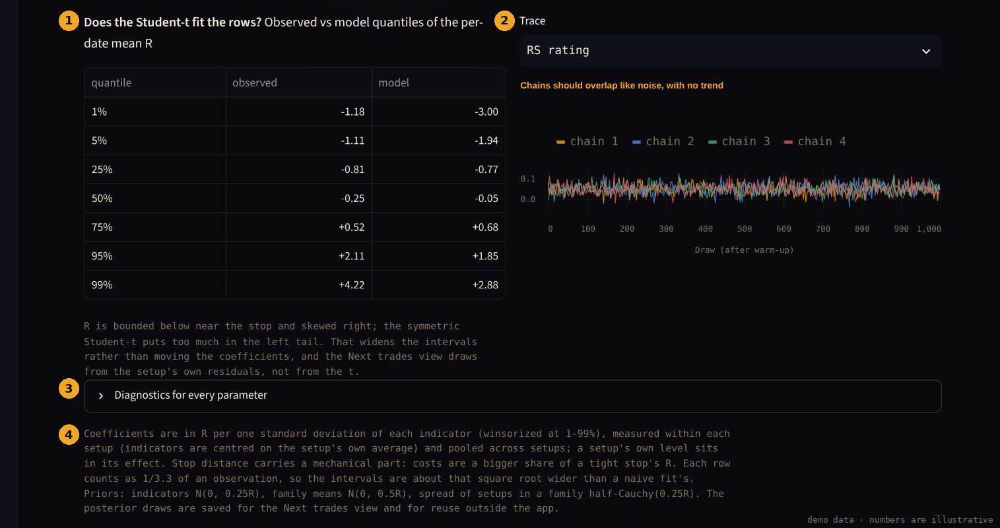

**1** Does the Student-t fit the rows? · **2** Trace · **3** Diagnostics for every parameter · **4** the model note

*Reading this example:* the model's 1% quantile is −3.00R against −1.18R observed, so the t puts too much in the left
tail, and the note under the table appears. The RS rating trace shows four chains overlapping as noise, which is what
healthy chains look like.

### How to act on view 2
- **Keep** an indicator in your selection process when it's green in-sample **and** the holdout IC has t ≥ 2.
- **Drop or ignore** indicators that are grey, or that flip between fits.
- **Re-weight setups** by the pooled dots, not the raw averages.

---

## 6. View 3 · Next trades (posterior predictive)

### What it does
Each posterior draw from view 2 is one plausible **true edge** for a setup. For each draw it simulates trades: that
draw's expected R plus the setup's own spread of outcomes (its real residuals, so stops, gaps and big winners keep
their shape). Then it asks how much to risk, and what the next N trades could look like.

It uses the **last fitted model**. If you changed indicators since, view 2 shows a stale-fit warning. If the ledger
was rebuilt, this view warns you too.

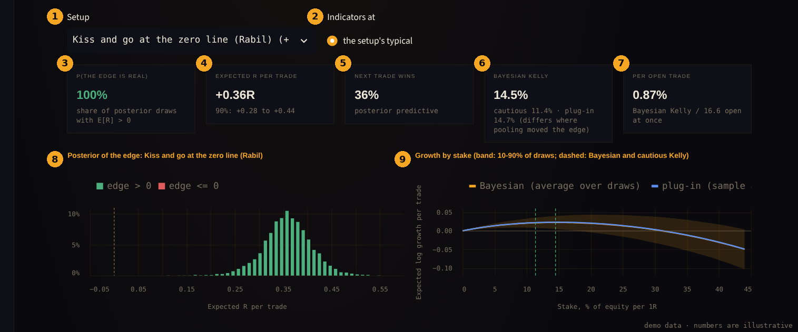

**1** Setup · **2** Indicators at · **3** P(the edge is real) · **4** Expected R per trade · **5** Next trade wins ·
**6** Bayesian Kelly · **7** Per open trade · **8** posterior of the edge · **9** growth by stake

*Reading this example:* the edge is clearly above zero (+0.36R, 90% band +0.28 to +0.44), yet only 36% of trades
win. This setup pays on the size of its winners, which is what trim and trail is built to keep. The Kellys are 14.5%
(Bayesian), 11.4% (cautious) and 14.7% (plug-in). *Per open trade* is small because the ledger had about 17 of these
open at once across 435 names. Use your own position count instead (see *Turning view 3 into a position size*).

### Controls

| Control | How and why |
|---|---|
| **Setup** | Sorted by pooled expected R. Start with the setups you actually trade. |
| **Indicators at** | **the setup's typical** is the average signal of that setup. **a Brief name's signal** (or **a live signal** when view 1 is on *Every signal*) puts in the indicators of a signal of this setup from view 1's list. Use it to size a specific trade; use *typical* to plan a setup's standing size. |
| **Live signal** | Appears with *a live signal*. |

### Reading the tiles
- **P(the edge is real)** is the share of posterior draws with expected R > 0. Green at 95% or more; red under 50%.
- **Expected R per trade** is the posterior median and 90% interval.
- **Next trade wins** is the posterior-predictive chance the next trade ends above 0R. Expect this to be modest for
  trend setups; they make money on the size of the winners.
- **Bayesian Kelly** is the stake (% of equity at risk per 1R, i.e. lost if the stop is hit) that maximizes expected log
  growth **averaged over the posterior**. The sub-line gives:
  - **cautious Kelly:** sized for the 10th-percentile edge
  - **plug-in Kelly:** the sample taken as truth

  They differ mostly where pooling moved the setup's edge.
- **Per open trade** is the Bayesian Kelly divided by the typical number of this setup's trades open at once in the
  ledger.

**Why three Kellys:**

- **Bayesian Kelly barely shrinks:** averaging over uncertainty in the mean only lowers it by about
  σ² / (σ² + Var(edge)), which is little when the edge is well measured against the trade noise.
- **Cautious Kelly:** the 10th-percentile version is the conservative answer to "what if the edge is weaker than it
  looks?".
- **Plug-in Kelly:** it shows what you'd bet if you believed the backtest.

### The charts
- **Posterior of the edge** shows the distribution of the setup's expected R, green above zero and red below. A wide
  posterior that touches zero is the picture of a setup you should size small.
- **Growth by stake** shows expected log growth per trade against stake: amber is Bayesian (the band is the 10–90% of
  posterior draws), blue is plug-in, and the dashed lines are the Bayesian and cautious Kelly. Past the peak, growth
  falls fast; at about twice Kelly it's back near zero. The band shows how many plausible edges would make a given
  stake lose.

### Stake for the fan, and the fan
| Control | Default | How and why |
|---|---|---|
| **Stake for the fan** | Half Bayesian Kelly | Choose Bayesian, half, cautious or a custom stake. Half Kelly keeps roughly three quarters of the growth with about half the volatility; full Kelly drawdowns are brutal. |
| **Custom % per 1R** | 1.00 | Your own risk per trade, to see what your current sizing implies. |
| **Trades** | 100 | How many trades ahead. Think "a year of this setup". |
| **Drawdown of (%)** | 20 | The drawdown you care about for the *P(a x% drawdown)* tile. |

The tiles, each Bayesian with plug-in underneath:

- **P(a x% drawdown):** the chance of at least that drawdown at some point over the next N trades.
- **P(behind after N trades):** the chance of ending below where you started.
- **Median ending equity:** the typical ending multiple.
- **Median worst drawdown:** the typical deepest drawdown along the way.
- **Stake:** the stake used.

**The equity fan** is drawn on a log scale.

- **Amber (Bayesian):** each path keeps **one draw of the edge for all its trades**. A path that drew a weak edge stays
  weak, so the fan spreads with the number of trades, not with its square root. That is the honest picture when you
  don't know the true edge.
- **Blue dashed (plug-in):** the 5/50/95% paths from resampling the realized trades as if the sample were the truth.

The gap between them is the cost of not knowing your edge.

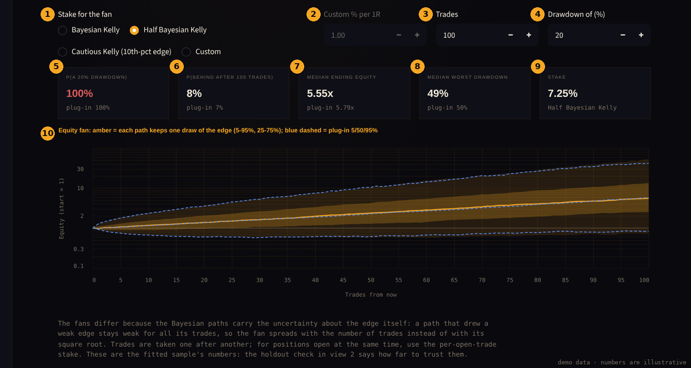

**1** Stake for the fan · **2** Custom % per 1R · **3** Trades · **4** Drawdown of (%) · **5** P(a x% drawdown) ·
**6** P(behind after N trades) · **7** Median ending equity · **8** Median worst drawdown · **9** Stake · **10** the
equity fan

*Reading this example:* even half Bayesian Kelly is 7.25% of equity per trade here. At that stake a 20% drawdown is
certain, and the typical worst drawdown is 49%, despite a strong edge. That's why steps 2 and 3 below divide the
stake by your open positions and cap it.

### Turning view 3 into a position size
1. Start from **Half Bayesian Kelly** or **cautious Kelly**, whichever is smaller.
2. **Divide by the number of positions you actually run at once**, not the ledger's "open at once" figure. That
   counts every name the setup fires on; if you cap yourself at 6 positions, divide by about 6.
3. **Cap it** by your own per-trade loss limit.
4. Check the fan at that stake: if *P(a 20% drawdown)* is more than you'd stomach, go lower.

**Trades in the fan are one after another.** Positions open at the same time share risk, which step 2 accounts for
roughly.

---

## 7. Cheat sheet: what good looks like

| Where | Read | Good | Caution |
|---|---|---|---|
| View 1 table | simulation verdict | supports | against, or *(thin)* |
| View 1 | Look-alikes used (effective) | ≥ 60 | < 30: a sketch only |
| View 1 | Look-alikes 90% band | entirely above 0 | straddles 0 |
| View 1 | Look-alikes vs all signals | higher | lower or equal: indicators add nothing here |
| View 1 | All signals vs uptrend names | higher | lower: the setup isn't beating random entries |
| View 1 | open at H | < 10% | > 20%: lengthen *Sessions simulated* |
| View 1 exit comparison | best 5% of trades, avg | well above the trim R | near the target: the exits cap the winners |
| View 1 exit comparison | median hold, winners vs losers | winners several times longer | about equal: the exits aren't sorting them |
| View 1 check | Information coefficient | > 0.05 | ≤ 0 |
| View 2 | Worst R-hat | < 1.01 | > 1.05: more draws |
| View 2 | Fewest effective draws | ≥ 400 | < 200 |
| View 2 | Indicator P(helps) | ≥ 95% (green) | 5–95% (grey) |
| View 2 holdout | Information coefficient t | ≥ 2 | < 1 |
| View 2 holdout | Out-of-sample R² | > 0 | < 0 with IC > 0: ranks well, sizes badly |
| View 3 | P(the edge is real) | ≥ 95% | < 80% |
| View 3 | P(a 20% drawdown) at your stake | < 25% | > 50% |

---

## 8. Messages you may see

| Message | Meaning | What to do |
|---|---|---|
| *This tab simulates from the Setup ledger's trades…* | No ledger yet | Press **Build the ledger with its current settings** |
| *The Brief's list appears once Brief > Setups has run…* | First load: the Brief runs after the Stocks tab | Click anything in the tab; the list is picked up |
| *None of the Brief's names has a ledger signal…* | The Brief's names fired outside the window, or on scans without a ledger setup | Raise *Signals from the last N sessions*, or use *Every signal* |
| *On the Brief but not simulated: …* | Those names have no ledger signal in the window | Read them on the Brief; nothing to simulate |
| *Forward paths read the daily bars… Switch the universe to Your list* | You're on the whole-market ledger | Switch *Universe* |
| *No setup fired in that many sessions* | Nothing in the window | Raise *Signals from the last N sessions* |
| *Only N past signals with H sessions of bars after them* | Not enough history for that window | Shorten *Sessions simulated* or load more history |
| *This signal has no stop level or ATR at its close* | Missing features on that signal | Pick another signal |
| *None of the simulated paths filled a trade* | Buy-stop entries that never triggered | Expected for some setups with buy stops |
| *Fewer than 30 effective look-alikes* | Thin neighbourhood | Fewer indicators, more look-alikes, or rely on view 2 |
| *…still open at session H…* | The window is too short for the exit | Lengthen *Sessions simulated* |
| *Too few signal dates to fit* | Under 50 rows or 10 per setup | Build a longer ledger, or fit on *All dates* |
| *Showing the last fit, made with different settings…* | Indicators or settings changed | Press **Fit the model** again |
| *The fitted model comes from a different ledger build* | Ledger rebuilt since the fit | Refit in view 2 |
| *Fewer than 20 completed trades for this setup in the fit sample* | Too thin to simulate | Pick a setup with more history |

---

## 9. Files, timing and where the methods come from

**Files written** (in `data/`, atomically):

- `sim_posterior.parquet`: every posterior draw, one column per parameter (`beta:<indicator>`, `a:<setup>`, `tau`,
  `sigma`, `nu`). If pyarrow isn't installed, it is written as `.csv.gz` instead.
- `sim_posterior.json`: when it was saved, the rows, the overlap k, the fit window and cutoff, the indicators, the
  scaler (so the standardization can be reproduced outside the app), and the setups.

Both are overwritten on each fit. Copy them if you want to compare fits over time.

**Timing** (measured on a 435-name list with five years of bars):

- a forward-path simulation for one signal: under 1 s
- the look-alike check: about 3 s
- a model fit: about 15 s for 13,000 signal dates at the defaults

Results are cached, so revisiting is instant.

**Methods:**

- **Filtered historical simulation**, i.e. rescaling past paths to today's volatility: Barone-Adesi, Giannopoulos &
  Vosper (1999).
- **Tricube kernel weights:** Cleveland (1979). **Effective sample size of weights:** Kish (1965).
- **Bayesian bootstrap:** Rubin (1981).
- **Hierarchical models, partial pooling and split R-hat:** Gelman et al., *Bayesian Data Analysis* (3rd ed.).
- **Half-Cauchy prior on the group scale:** Gelman (2006).
- **Student-t errors as a scale mixture:** Geweke (1993).
- **Tempered (coarsened) likelihood for dependent data:** the power-posterior idea; see Miller & Dunson (2019) and
  Grünwald (2012). The overlap factor comes from the Newey-West (1987) variance.
- **Kelly:**
  - growth criterion: Kelly (1956) and Thorp (1997)
  - Bayesian decision under parameter uncertainty: Browne & Whitt (1996)
  - shrinkage: Baker & McHale (2013)
- **Information coefficient** (rank correlation of forecasts with outcomes): Grinold & Kahn, *Active Portfolio
  Management*.
